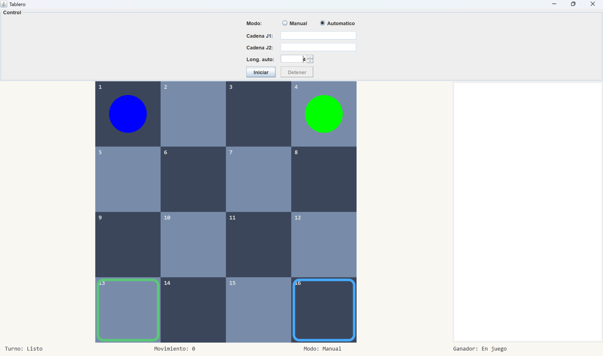
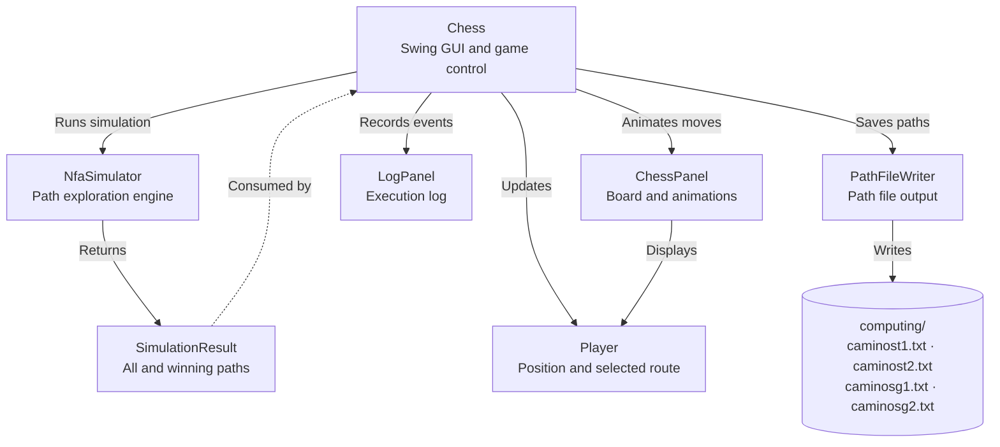
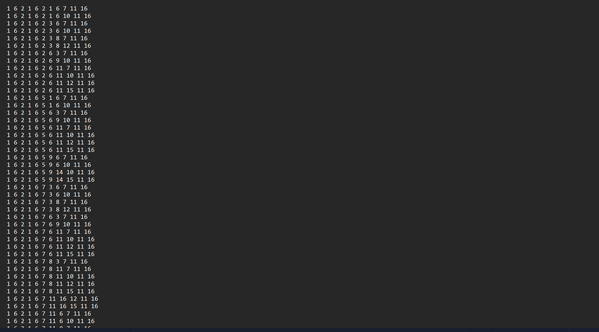

<h1 align="center">Chess NFA Simulator</h1>

<p align="center">
  <i>Non-Deterministic Finite Automaton implementation on a 4x4 chess board for two-player game simulation.</i>
</p>

<p align="center">
  
  
  
  
  
  
</p>

<p align="center">
  
</p>

---

## Introduction

Non-Deterministic Finite Automaton (NFA) implementation on a 4x4 chess board that simulates a game between two players. Each player moves according to an input string composed of characters `r` (red) and `b` (blue), which determine the type of movement allowed at each step. Features path exploration, collision detection, and automatic log generation.

The formal documentation of this project is available in the [tablero.pdf report](latex/tablero.pdf), which covers the theoretical foundations, the current program behavior, algorithms, and results with screenshots.

---

## Table of Contents

- [Introduction](#introduction)
- [Table of Contents](#table-of-contents)
- [Description](#description)
- [System Architecture](#system-architecture)
  - [Core Components](#core-components)
- [Project Structure](#project-structure)
- [Technology Stack](#technology-stack)
  - [Backend \& Core](#backend--core)
  - [Data Structures](#data-structures)
- [Prerequisites](#prerequisites)
  - [Installation Verification](#installation-verification)
- [Installation and Execution](#installation-and-execution)
  - [Step 1: Clone or Download Files](#step-1-clone-or-download-files)
  - [Step 2: Compile the Project](#step-2-compile-the-project)
  - [Step 3: Run the Simulator](#step-3-run-the-simulator)
  - [Step 4: Select Game Mode](#step-4-select-game-mode)
- [Game Characteristics](#game-characteristics)
  - [Board Setup](#board-setup)
  - [Players](#players)
  - [Movement System (NFA)](#movement-system-nfa)
  - [Game Modes](#game-modes)
- [NFA Processing](#nfa-processing)
  - [Alphabet Definition](#alphabet-definition)
  - [State Transitions](#state-transitions)
  - [Path Calculation](#path-calculation)
- [Turn System and Collisions](#turn-system-and-collisions)
  - [Turn Rules](#turn-rules)
  - [Collision Detection](#collision-detection)
  - [Collision Resolution](#collision-resolution)
- [Victory Conditions](#victory-conditions)
- [Data Model](#data-model)
  - [Class: Player](#class-player)
  - [Class: NfaSimulator](#class-nfasimulator)
  - [Class: SimulationResult](#class-simulationresult)
  - [Class: ChessPanel](#class-chesspanel)
  - [Class: GameConfig](#class-gameconfig)
  - [Class: PathFileWriter](#class-pathfilewriter)
  - [Interface: BoardStateProvider](#interface-boardstateprovider)
- [Useful Commands](#useful-commands)
  - [Compilation](#compilation)
  - [Execution](#execution)
  - [Verification](#verification)
- [System Features](#system-features)
  - [Functionalities](#functionalities)
  - [User Interface](#user-interface)
  - [Simulation Control](#simulation-control)
- [Usage Examples](#usage-examples)
  - [Example 1: Manual Mode](#example-1-manual-mode)
  - [Example 2: Automatic Mode](#example-2-automatic-mode)
  - [Example 3: Random String Generation](#example-3-random-string-generation)
  - [Generated Output Files](#generated-output-files)
- [Troubleshooting](#troubleshooting)
  - [Error: "Main class not found"](#error-main-class-not-found)
  - [Error: Incompatible Java version](#error-incompatible-java-version)
  - [Window does not display](#window-does-not-display)
  - [Output files not generated](#output-files-not-generated)
  - [Invalid input strings](#invalid-input-strings)
  - [Simulation stuck or too fast](#simulation-stuck-or-too-fast)
- [Author](#author)
- [License](#license)

---

## Description

Non-Deterministic Finite Automaton (NFA) implementation on a 4x4 chess board that simulates a game between two players. Each player moves according to an input string composed of characters `r` (red/rook) and `b` (blue/bishop), which determine orthogonal or diagonal movements respectively.

| Component | Description |
|----------|-------------|
| Board | 4x4 grid (16 positions) |
| Players | 2 players (Blue and Green) |
| Alphabet | {r, b} |
| Modes | Manual and Automatic |
| Output | 4 text files with paths |

---

## System Architecture



### Core Components

**Model:**
- **Player** - Player representation with state management
- **NfaSimulator** - NFA simulation engine
- **SimulationResult** - Data Transfer Object for results

**View:**
- **ChessPanel** - Visual chess board component
- **InfoPanel** - Game information display
- **LogPanel** - Movement log panel
- **ControlPanel** - User control interface

**Utilities:**
- **GameConfig** - Static configuration constants
- **PathFileWriter** - File output handler
- **BoardStateProvider** - Interface for board state access

---

## Project Structure

```
ChessNFA/
├── Chess.java                  # Main class and game coordinator
├── Player.java                 # Player model with state management
├── NfaSimulator.java           # NFA simulation engine
├── SimulationResult.java       # DTO for simulation results
├── ChessPanel.java             # Visual chess board component
├── InfoPanel.java              # Information display panel
├── LogPanel.java               # Movement log panel
├── ControlPanel.java           # User control interface
├── GameConfig.java             # Configuration constants
├── PathFileWriter.java         # File writer for paths
├── BoardStateProvider.java     # Interface for board state
├── .gitignore                  # Git ignored files
├── computing/                  # Computation history directory
│   ├── caminost1.txt           # All paths for Player 1 (output)
│   ├── caminost2.txt           # All paths for Player 2 (output)
│   ├── caminosg1.txt           # Winning paths for Player 1 (output)
│   └── caminosg2.txt           # Winning paths for Player 2 (output)
└── README.md                   # This file
```

---

## Technology Stack

### Backend & Core

| Technology | Version | Usage |
|-----------|---------|------|
| Java SE | 8+ | Main language |
| Swing | Built-in | GUI framework |
| AWT | Built-in | Graphics and events |
| Collections | Built-in | Data structures |
| I/O | Built-in | File handling |
| Timer | Built-in | Animation control |

### Data Structures

| Structure | Usage |
|-----------|------|
| ArrayList | Path storage and player state |
| HashSet | Next state calculations |
| List | Path collections |
| Set | Unique state management |

---

## Prerequisites

- JDK 8 or higher
- Operating system: Windows, Linux, or macOS

### Installation Verification

```bash
java -version
javac -version
```

Expected output:
```
java version "1.8.x" or higher
javac 1.8.x
```

---

## Installation and Execution

### Step 1: Clone or Download Files

```bash
# If in a repository
git clone <repository-url>
cd ESCOM/ChessNFA

# Or manually download all .java files
```

### Step 2: Compile the Project

```bash
javac *.java
```

This command compiles all Java files in the current directory.

### Step 3: Run the Simulator

```bash
java Chess
```

The application window will open with the control panel.

### Step 4: Select Game Mode

1. **Manual Mode**: Select option 1 and enter strings manually
2. **Automatic Mode**: Select option 2 for random generation and auto-play

---

## Game Characteristics

### Board Setup

```
+----+----+----+----+
| 1  | 2  | 3  | 4  |  ← Player 2 starts here (4)
+----+----+----+----+
| 5  | 6  | 7  | 8  |
+----+----+----+----+
| 9  | 10 | 11 | 12 |
+----+----+----+----+
| 13 | 14 | 15 | 16 |  ← Player 1 goal (16)
+----+----+----+----+
  ↑                 ↑
  P1 starts       P2 goal
```

**Board Properties:**
- 4x4 grid = 16 total positions
- Position numbering: 1-16
- Tile size: 100x100 pixels
- Alternating colors: Dark and Light squares
- Goal positions highlighted

### Players

| Player | Start Position | Goal Position | Color | Token |
|--------|---------------|---------------|-------|-------|
| Player 1 | 1 | 16 | Blue | Blue circle |
| Player 2 | 4 | 13 | Green | Green circle |

### Movement System (NFA)

The program uses a two-symbol alphabet for input:

**`r` (Red/Rook):** Orthogonal movements
- Up (position - 4)
- Down (position + 4)
- Left (position - 1)
- Right (position + 1)

**`b` (Blue/Bishop):** Diagonal movements
- Upper-left diagonal (position - 5)
- Upper-right diagonal (position - 3)
- Lower-left diagonal (position + 3)
- Lower-right diagonal (position + 5)

### Game Modes

**Manual Mode:**
- User manually enters movement strings for both players
- Option to type `random` for automatic string generation
- Input validation (only 'r' and 'b' characters)
- Both strings must have equal length

**Automatic Mode:**
- Automatically generates random strings for both players
- Random length between 3-14 characters
- Automatic simulation with 2-second intervals
- Can be stopped by pressing ENTER

---

## NFA Processing

### Alphabet Definition

**Σ = {r, b}**

- **r**: Rook-like orthogonal movements
- **b**: Bishop-like diagonal movements

### State Transitions

**States (Q):** {1, 2, 3, 4, 5, 6, 7, 8, 9, 10, 11, 12, 13, 14, 15, 16}

**Transition Function (δ):**

For each position and symbol, the NFA computes all valid next positions:

| Current Position | Symbol | Valid Next Positions |
|-----------------|--------|---------------------|
| 1 | r | {2, 5} |
| 1 | b | {6} |
| 6 | r | {2, 5, 7, 10} |
| 6 | b | {1, 3, 10, 11} |
| ... | ... | ... |

The transitions respect board boundaries (4x4 grid constraints).

### Path Calculation

The simulator:
1. Explores **all possible paths** from initial state
2. Applies non-deterministic transitions for each input symbol
3. Generates complete path tree for entire input string
4. Filters **winning paths** that reach the goal state
5. Saves results to text files

---

## Turn System and Collisions

### Turn Rules

- Turns alternate between players
- First turn is randomly assigned at game start
- Turn only changes when both players successfully move
- Turn remains with current player during collision resolution

### Collision Detection

A collision occurs when:
- Both players attempt to move to the same position
- Detected before movement is executed
- Triggers special resolution logic

### Collision Resolution

**Priority System:**
1. Player with current turn maintains their movement
2. Player without turn is redirected to alternative winning path
3. If no alternative path exists, player cedes and stays in place
4. Turn does not change until collision is resolved
5. Visual indicator shows collision position

---

## Victory Conditions

A player wins when:
- They reach their goal position (16 for P1, 13 for P2)
- Visual indicator highlights the winner
- Winner announcement displayed with "¡GANADOR!" text
- Game automatically resets after 3 seconds

**Other End Conditions:**
- No winner: Moves exhausted without reaching goal
- No winning paths: Player has no valid paths to goal
- Manual stop: User presses ENTER during simulation

---

## Data Model

### Class: Player

Represents an individual player with state management.

| Field | Type | Description |
|-------|------|-------------|
| name | String | Player name |
| initialState | int | Starting position (1 or 4) |
| finalState | int | Goal position (16 or 13) |
| tokenColor | Color | Visual token color |
| input | String | Movement input string |
| paths | List\<List\<Integer\>\> | All possible paths |
| winningPaths | List\<List\<Integer\>\> | Paths reaching goal |
| currentPath | List\<Integer\> | Currently followed path |
| currentPosition | int | Current board position |

**Main methods:**
- `setInput(String)` - Set movement string
- `setPaths(List)` - Store all paths
- `setWinningPaths(List)` - Store winning paths
- `selectRandomWinningPath()` - Choose random winning path
- `selectAlternativeWinningPath(int)` - Find alternative path avoiding position
- `resetPosition()` - Reset to initial state

### Class: NfaSimulator

Core NFA simulation engine.

| Field | Type | Description |
|-------|------|-------------|
| boardSize | int | Board dimension (4x4) |

**Main methods:**
- `simulate(String input, int initialState, int finalState)` - Run complete NFA simulation
- `nextStates(int currentState, char color)` - Calculate valid next states
- Returns SimulationResult with all paths and winning paths

### Class: SimulationResult

Data Transfer Object for simulation results.

| Field | Type | Description |
|-------|------|-------------|
| allPaths | List\<List\<Integer\>\> | All explored paths |
| winningPaths | List\<List\<Integer\>\> | Paths reaching goal state |

### Class: ChessPanel

Visual component rendering the chess board.

| Field | Type | Description |
|-------|------|-------------|
| player1 | Player | Reference to player 1 |
| player2 | Player | Reference to player 2 |
| stateProvider | BoardStateProvider | Board state interface |
| animating | boolean | Animation in progress |
| collisionHighlightCell | int | Cell to highlight for collision |

**Main methods:**
- `paintComponent(Graphics)` - Render board, players, and effects
- `animateMove(...)` - Animate smooth movement transitions
- `highlightCollision(int)` - Show collision indicator
- `drawWinnerIndicator(...)` - Display winner highlight

### Class: GameConfig

Static configuration class.

| Constant | Type | Value | Description |
|----------|------|-------|-------------|
| BOARD_SIZE | int | 4 | Board dimension |
| TILE_SIZE | int | 100 | Tile size in pixels |
| WINDOW_SIZE | int | 400 | Window size (BOARD_SIZE * TILE_SIZE) |
| MAX_INPUT_LENGTH | int | 12 | Maximum input string length |
| COLOR_BACKGROUND | Color | RGB(248,247,242) | Background color |
| COLOR_DARK_SQUARE | Color | RGB(60,70,90) | Dark square color |
| COLOR_LIGHT_SQUARE | Color | RGB(120,140,170) | Light square color |
| COLOR_GOAL_P1 | Color | RGB(70,170,255) | Player 1 goal highlight |
| COLOR_GOAL_P2 | Color | RGB(90,200,120) | Player 2 goal highlight |
| COLOR_COLLISION | Color | RGB(220,80,90) | Collision indicator |

### Class: PathFileWriter

Handles file output operations.

**Main methods:**
- `writePaths(List<List<Integer>> paths, String fileName)` - Write paths to file

**Output format:**
```
1 2 3 7 11 15 16
1 5 6 7 11 15 16
1 6 7 8 12 16
...
```

Each line represents one path as space-separated states.

### Interface: BoardStateProvider

Interface for board state access (decoupling).

**Methods:**
- `int getPlayer1Position()` - Get player 1 current position
- `int getPlayer2Position()` - Get player 2 current position
- `boolean isShowingWinner()` - Check if winner is displayed
- `boolean isWinnerPlayer1()` - Check if player 1 won

---

## Useful Commands

### Compilation

```bash
# Compile all files
javac *.java

# Compile with warnings
javac -Xlint *.java

# Compile specific order
javac GameConfig.java Player.java SimulationResult.java BoardStateProvider.java
javac PathFileWriter.java NfaSimulator.java ChessPanel.java Chess.java

# Clean compiled files
rm *.class
# Windows PowerShell:
# Remove-Item *.class
```

### Execution

```bash
# Run the application
java Chess

# Run with more memory (optional)
java -Xmx512m Chess

# Run with verbose output
java -verbose Chess
```

### Verification

```bash
# List generated .class files
ls *.class
# Windows PowerShell:
# Get-ChildItem *.class

# Check generated output files
ls caminos*.txt
# Windows PowerShell:
# Get-ChildItem caminos*.txt

# View path file content
cat caminosg1.txt
# Windows PowerShell:
# Get-Content caminosg1.txt

# Count paths in file
wc -l caminost1.txt
# Windows PowerShell:
# (Get-Content caminost1.txt).Length
```

---

## System Features

### Functionalities

- Non-deterministic finite automaton implementation
- 4x4 chess board visualization
- Two-player game simulation
- Orthogonal and diagonal movement rules
- Complete path exploration (NFA)
- Winning path filtering
- Automatic file generation (4 output files)
- Turn-based gameplay
- Collision detection and resolution
- Alternative path selection
- Visual winner indication
- Manual and automatic modes
- Random string generation
- Input validation
- Smooth movement animations
- Real-time position updates

### User Interface

- 450x670 pixel window
- 4x4 grid with 100x100 pixel tiles
- Position numbers on each tile
- Colored player tokens (circles)
- Goal position highlighting
- Collision indicators
- Winner visual effects
- Information panel with game status
- Movement log panel
- Control panel for user input
- Smooth animations (250ms duration)

### Simulation Control

- Simulation can be stopped by pressing ENTER
- Automatic reset after game completion
- 2-second interval between automatic moves
- Console messages for game state
- Real-time visual updates
- Pause/resume capability

---

## Usage Examples

### Example 1: Manual Mode

**Console Interaction:**
```
Seleccione el modo de juego:
1. Modo Manual
2. Modo Automático
Opción: 1

Ingrese la cadena para el Jugador 1 (solo 'r' y 'b'): rrbb
Ingrese la cadena para el Jugador 2 (solo 'r' y 'b'): brbb
```

**Process:**
1. System calculates all paths for both players
2. Filters winning paths
3. Saves to files in the `computing/` directory:
   - `computing/caminost1.txt`: All P1 paths
   - `computing/caminosg1.txt`: P1 winning paths
   - `computing/caminost2.txt`: All P2 paths
   - `computing/caminosg2.txt`: P2 winning paths
4. Simulation begins with visual representation

<p align="center">
  
  <br>
  <i>Complete computation history: all paths and winning paths for each player</i>
</p>

**Output:**
```
Jugador 1 - Cadena: rrbb
Total de caminos: 24
Caminos ganadores: 3

Jugador 2 - Cadena: brbb
Total de caminos: 18
Caminos ganadores: 2

--- Iniciando simulación ---
Turno inicial: Jugador 1
Movimiento 1: J1 -> 2, J2 -> 8
Movimiento 2: J1 -> 3, J2 -> 7
...
¡Jugador 1 ha ganado!
```

### Example 2: Automatic Mode

**Console Interaction:**
```
Seleccione el modo de juego:
1. Modo Manual
2. Modo Automático
Opción: 2
```

**Process:**
1. System generates random strings (length 3-14)
2. Example: P1: `rrbbrrbr`, P2: `brrbbrrb`
3. Automatic path calculation
4. Automatic simulation at 2-second intervals
5. Press ENTER to stop

### Example 3: Random String Generation

**In Manual Mode:**
```
Ingrese la cadena para el Jugador 1: random
Cadena generada: rbbrrbrb

Ingrese la cadena para el Jugador 2: brrbbb
Error: Las cadenas deben tener la misma longitud
Ingrese la cadena para el Jugador 2: random
Cadena generada: brrbrbrb
```

### Generated Output Files

All computation history files are saved in the `computing/` directory:

**computing/caminosg1.txt** (Winning paths for Player 1):
```
1 2 3 7 11 15 16
1 5 6 10 14 15 16
1 6 11 15 16
```

**computing/caminost1.txt** (All paths for Player 1):
```
1 2 3 7 11 15 16
1 2 3 7 11 15 14
1 2 3 7 11 12 16
1 2 3 7 11 12 13
1 2 3 7 11 10 14
...
```

---

## Troubleshooting

### Error: "Main class not found"

```bash
# Verify files are compiled
ls *.class

# Recompile
javac *.java

# Run from correct directory
java Chess
```

### Error: Incompatible Java version

```bash
# Check version
java -version

# If less than 8, update JDK
# Download from: https://www.oracle.com/java/technologies/downloads/
```

### Window does not display

```bash
# Verify DISPLAY is configured (Linux)
echo $DISPLAY

# On Windows, check for permission errors
# Run as administrator if necessary

# Verify Java GUI support
java -version
```

### Output files not generated

```bash
# Check write permissions
ls -la

# Windows PowerShell:
# Get-Acl .

# Verify files exist after simulation
ls computing/caminos*.txt

# Check for error messages in console
```

### Invalid input strings

**Common errors:**
- String contains characters other than 'r' and 'b'
- Strings have different lengths
- Empty strings

**Solution:**
```bash
# Valid examples:
rrbb
brbr
rrrr
bbbb

# Invalid examples:
rrab  # Contains 'a'
RGB   # Uppercase
12    # Numbers
```

### Simulation stuck or too fast

**Too slow:**
- Check computer performance
- Reduce animation complexity
- Use shorter input strings

**Too fast:**
- Modify timer interval in [Chess.java](Chess.java)
- Change automatic mode delay

```java
// In Chess.java, modify timer interval:
simulationTimer = new Timer(2000, e -> executeNextMove());
// Change 2000 to 3000 for slower (3 seconds)
```

---

## Author

**Carlos Elias Linares Ojeda**
- Group: 4CM2
- Course: Theory of Computation
- Institution: ESCOM-IPN
- Version: 4.0
- Date: April 7, 2025

---

## License

This project was developed for academic purposes for the Theory of Computation course at ESCOM-IPN.
